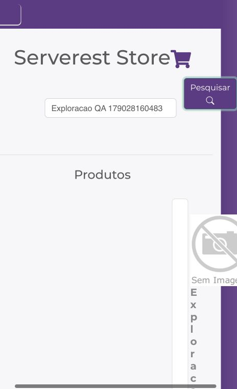
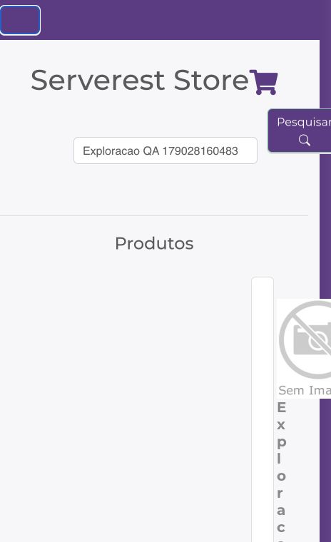
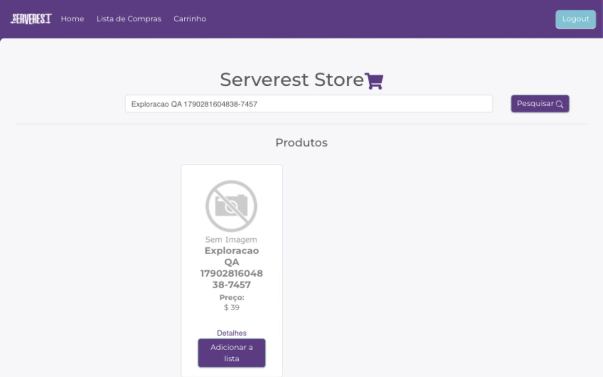
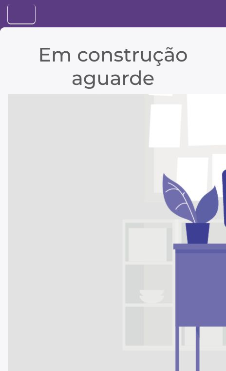

# Relatório complementar de exploração do front — 24/09/2026

Aplicação: https://front.serverest.dev/ · API de apoio: https://serverest.dev/.
Navegador Chromium, identificado como Chrome 152.0.0.0, no macOS. A sessão de
cadastro começou sem as chaves de e-mail, senha e token no armazenamento.
Foram usadas apenas contas e produto descartáveis próprios.

**Material complementar à suíte de automação:** a entrega principal contém
48 cenários automatizados, sendo 33 de API e 15 E2E. Os achados desta exploração
não entram nessa contagem. As evidências registram observações pontuais feitas
no navegador e verificações de apoio pela API; não representam resultados
adicionais de execução da suíte.

O relato foi estruturado para avaliação técnica e triagem por desenvolvimento,
com contexto, passos de reprodução, resultado esperado e obtido, impacto e
evidências. A exploração não alterou a aplicação, as asserções ou o resultado
da suíte. As capturas são originais, sem edição. Os JSONs registram verificações
do navegador e da limpeza da massa, sem senhas ou tokens.

| Referência | Resultado | Classificação |
| --- | --- | --- |
| OBS-02 | Cadastro grava a senha informada no `localStorage` | Armazenamento de senha confirmado; risco de segurança com severidade sugerida alta |
| OBS-06 | Botão de navegação não expande o menu em 464 px | Defeito funcional reproduzido; severidade sugerida média |
| OBS-03 | Carrinho exibe “Em construção aguarde” | Limitação anunciada pela aplicação |

As severidades são propostas para triagem, considerando que se trata de uma
aplicação pública de estudos. Não houve reporte ao mantenedor.

## OBS-02 — Senha persistida no cadastro

**Relação com a suíte:** os cenários automatizados cobrem cadastro e logout,
mas não verificam a persistência da senha durante o cadastro. Essa observação
complementa as validações desses fluxos.

**Passos de reprodução**

1. Abrir o front numa sessão sem as chaves `serverest/userEmail`,
   `serverest/userPassword` e `serverest/userToken`.
2. Clicar em “Cadastre-se” e cadastrar um usuário comum com dados descartáveis.
3. Depois do redirecionamento para `/home`, ler `serverest/userPassword` no
   armazenamento local e comparar com a senha informada.
4. Encerrar a sessão pelo botão “Logout”.

**Esperado:** a autenticação não deve manter a senha em armazenamento
persistente acessível aos scripts da origem.

**Obtido:** a comparação entre a senha armazenada e a informada foi verdadeira.
O e-mail correspondia à conta descartável e havia token de sessão. Após o
logout, as três chaves estavam ausentes.

A [evidência técnica](evidencias/exploracao-2026-09-24/cadastro-localstorage.json)
registra o estado antes do cadastro, depois dele e depois do logout. Foi usada
uma comparação booleana para não incluir a credencial no relatório. Um print
da página autenticada, sozinho, não comprovaria o conteúdo do armazenamento.

A origem do armazenamento é o **cadastro**. O
[JavaScript público do front](https://front.serverest.dev/static/js/main.63e8c0e3.chunk.js)
grava a senha nesse fluxo; o fluxo de login grava e-mail e token. Uma senha
observada depois de um login pode ter permanecido de um cadastro anterior.

**Impacto e limite:** a senha fica acessível a scripts executados na mesma
origem. A observação não demonstra exploração de XSS nem acesso indevido a
outras contas. A recomendação de evitar dados sensíveis no armazenamento local
segue o [guia da OWASP](https://cheatsheetseries.owasp.org/cheatsheets/HTML5_Security_Cheat_Sheet.html#local-storage).

## OBS-06 — Menu não expande em janela estreita

**Relação com a suíte:** não há cenário automatizado específico para a abertura
do menu em 464 px. O achado acrescenta uma verificação exploratória de
navegação nessa largura.

**Passos de reprodução**

1. Autenticar um usuário comum e abrir `/home` com viewport de **464 × 760 px**.
2. Clicar no botão de navegação no canto superior esquerdo, cujo nome acessível
   é “Toggle navigation”.
3. Verificar a exibição dos links de navegação e do botão de logout.
4. Repetir a abertura do menu em `/carrinho`.
5. Comparar `/home` com viewport de **1280 × 800 px**.

**Esperado:** o botão deve expandir a navegação quando ela estiver recolhida,
permitindo acessar os links e encerrar a sessão.

**Obtido:** em 464 px, o clique não revelou os itens. `aria-expanded` permaneceu
`false` em `/home` e `/carrinho`. Em `/home`, “Home”, “Lista de Compras”,
“Carrinho” e “Logout” continuaram ocultos. Em 1280 px, esses controles estavam
visíveis e o logout funcionou.

**Impacto:** a navegação pelo menu e o logout ficam indisponíveis na largura
verificada. Os prints também mostram conteúdo cortado na janela estreita;
não foi feita uma investigação separada da causa do layout. O resultado não
estabelece o comportamento de todas as larguras, navegadores ou dispositivos.

[Leituras do DOM e dimensões](evidencias/exploracao-2026-09-24/menu.json).

Antes do clique, em 464 × 760 px:

Depois do clique, na mesma largura:

Comparação em 1280 × 800 px:

## OBS-03 — Carrinho em construção

**Relação com a suíte:** documenta o limite da cobertura E2E, que chega até a
lista de compras. Os comportamentos de carrinho são testados pela API em
`carrinhos.feature`.

**Pré-condições:** usuário comum autenticado e produto descartável disponível
na vitrine, criado para a sessão de teste.

**Reprodução:** buscar o produto temporário, adicionar à lista e clicar em
“Adicionar no carrinho”. A navegação chega a `/carrinho`, que mostra
“Em construção aguarde”, sem um fluxo de conclusão de compra.

Essa mensagem anuncia uma funcionalidade ainda não implementada. Foi registrada
como limitação de cobertura, sem classificá-la como defeito novo nem presumir
um requisito de checkout que não foi fornecido.

## Demais verificações e limpeza

A busca localizou o produto próprio pelo nome. A lista mostrou uma unidade por
R$ 39; aumentar a quantidade para duas atualizou o valor para R$ 78; diminuir
para uma restaurou R$ 39. O logout, acessível na largura desktop, removeu as
chaves de e-mail, senha e token.

Ao terminar, foram excluídos o produto e as quatro contas criadas para esta
exploração. Consultas posteriores por ID e por e-mail confirmaram a ausência
dos registros. O [registro de limpeza](evidencias/exploracao-2026-09-24/limpeza.json)
não contém credenciais. A largura temporária de comparação foi restaurada.

Os comportamentos refletem a aplicação pública na data da execução. Esta
exploração não substitui uma auditoria de segurança ou de compatibilidade.
